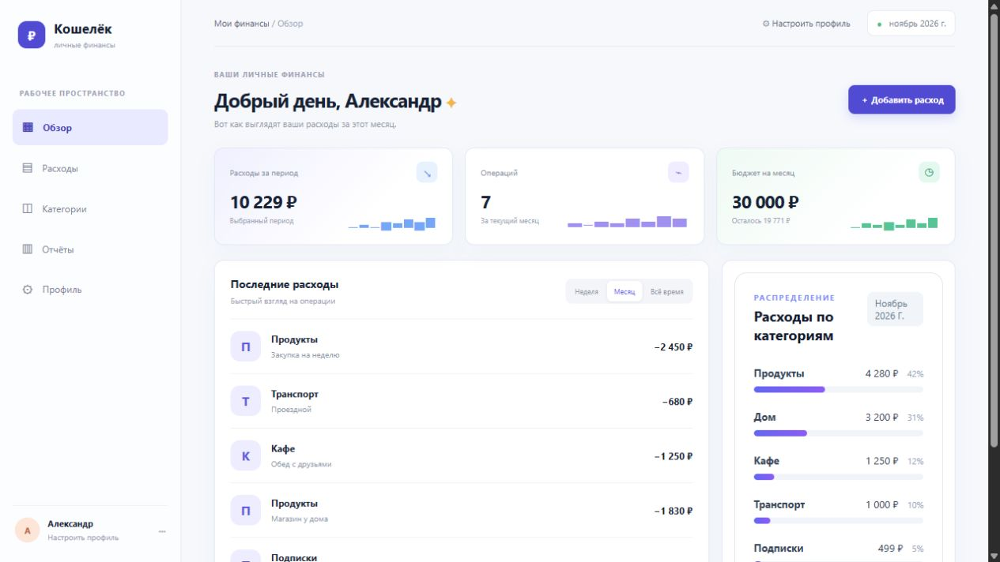
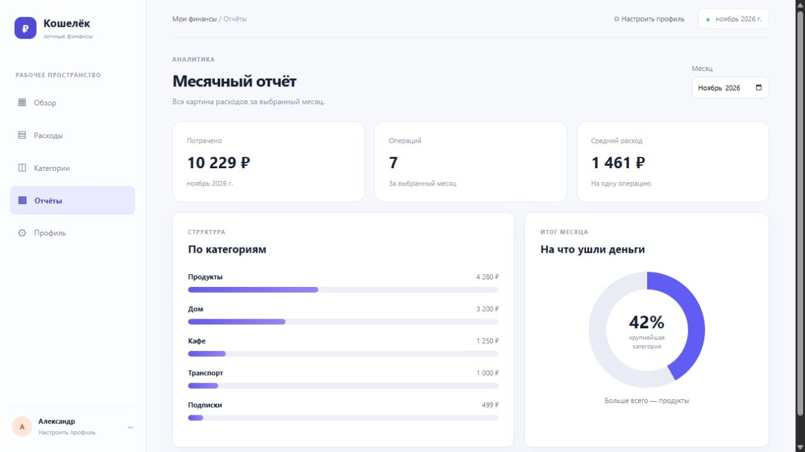

# Кошелёк — органайзер личных расходов

Курсовой проект по теме «Разработка органайзера личных расходов с категориями, месячными отчётами и диаграммами с использованием языка JavaScript». Приложение написано на TypeScript (компилируется в JavaScript), React и Vite. Оно позволяет добавлять, изменять и удалять расходы, смотреть категории, бюджет и месячный отчёт. Данные хранятся локально в браузере (`localStorage`), поэтому синхронизации между устройствами пока нет.

Проект состоит из приложения `frontend` и библиотеки компонентов `ui-library`. Подробности — в [architecture.md](architecture.md), границы первой версии — в [mvp.md](mvp.md).

## Запуск

Нужны Node.js и npm. Из корня проекта последовательно выполните:

```sh
cd ui-library
npm ci
npm run build
cd ../frontend
npm ci
npm run dev
```

Откройте адрес, который напечатает Vite (обычно `http://127.0.0.1:5173/`). Сначала собирается библиотека, затем запускается приложение. В каждой из двух папок также работают команды `npm run build`, `npm run dev`, `npm run lint`, `npm run lint:fix`, `npm test`, `npm run test:coverage`.

## Разделы

- `/` — обзор: показатели, пять последних расходов и категории;
- `/expenses` — полная история операций с фильтром, сортировкой и редактированием;
- `/categories` — распределение текущего месяца;
- `/reports` — выбор месяца, сводка и диаграммы;
- `/profile` — имя и бюджет.

## Примеры работы

Главная страница с компактным списком вместо большой таблицы:



Месячный отчёт и диаграммы:


